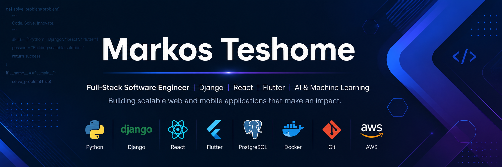

  

<h1 align="center">Hi 👋, I'm Markos Teshome</h1>

<h3 align="center">
Full-Stack Software Engineer | Django & React Developer | Flutter Developer | AI & Machine Learning Enthusiast
</h3>

Building scalable web applications, mobile apps, and intelligent software solutions.

  <a href="https://markos-portfolioo.netlify.app">🌐 Portfolio</a> •
  <a href="https://www.linkedin.com/in/markos-teshome-40b061336">💼 LinkedIn</a> •
  <a href="https://x.com/MarkosTesh25364">🐦 X</a> •
  <a href="https://www.instagram.com/zeanbesa7066">📷 Instagram</a> •
  <a href="mailto:zeanbesa7066@gmail.com">📧 Email</a>

---

## 👨‍💻 About Me

🎓 B.Sc. in Software Engineering &nbsp;|&nbsp; 📍 Bahir Dar, Ethiopia

I build full-stack web and mobile applications with Django, React, and Flutter, with a strong interest in backend engineering, cloud computing, system design, and AI/ML.

🌱 **Currently learning:** Next.js, Docker, Kubernetes, AWS, CI/CD, Microservices

---

## 🛠 Tech Stack

| Category | Technologies |
|----------|--------------|
| **Languages** | Python, JavaScript, TypeScript, Dart, SQL, HTML5, CSS3 |
| **Frontend** | React, Next.js, Tailwind CSS, Bootstrap, Material UI |
| **Backend** | Django, Django REST Framework, REST APIs, JWT Authentication |
| **Mobile** | Flutter |
| **Databases** | PostgreSQL, MySQL, SQLite |
| **Tools** | Git, GitHub, Docker, Postman, Figma, VS Code |

---

## 🚀 Featured Projects

**🚦 Road Traffic Control System**
Traffic management platform for the Amhara Regional Traffic Authority: driver and vehicle verification, citation management, digital payments, admin dashboard, REST API, and mobile app.
`Django` `DRF` `React` `Flutter` `PostgreSQL`

**🎓 Ethiopics Global University**
Online education platform connecting Ethiopian tutors with language learners worldwide.

**📒 React Django Notes App**
Full-stack notes application built with React, Django REST Framework, and PostgreSQL.

**📝 Django Blog API**
RESTful blogging platform with authentication, CRUD operations, and modern API architecture.

---

## 💼 Experience

**Software Engineer** — Doctor Nega Education Center
Developed educational software and responsive web applications, maintained backend APIs, and collaborated with development teams.

---

## 🎯 2026 Goals

Build scalable SaaS applications • Contribute to open source • Earn AWS Cloud Certification • Master DevOps practices

---

<i>"Code with purpose. Build solutions that create impact."</i>

